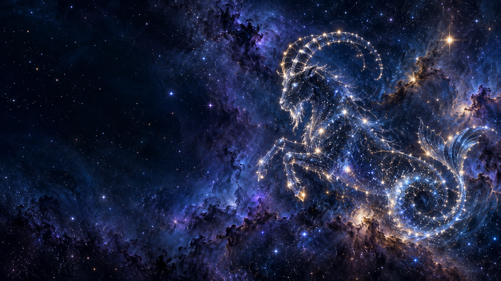

# Zodiac Nebula Interaction



   

一个面向创作者与开发者的星座星云互动 Skill。以摩羯座指尖星空为范例，帮助制作由手势驱动的星尘轨迹、行星轨道与星座揭晓网页体验。

## 功能特点

- 将连续的指尖跟踪与一次性手势事件分开设计，减少误触发。
- 以捏合、张掌、点赞、V 手势串联星群、星云、行星与摩羯星图。
- 用 Canvas 星点逐步显现可辨认的山羊星群、星座连线、标志和 `CAPRICORN` 字样。
- 以本机浏览器处理 MediaPipe 手部关键点，保留鼠标与触控备用操作。
- 面向录屏优化画面节奏、星尘速度和竖屏布局。

## 适用场景

- 制作摩羯座或其他星座主题的手势互动网页。
- 把静态星图设计成逐渐形成、清晰定格的星云揭晓效果。
- 为抖音、TikTok 等短视频录制准备可操作的浏览器画面。

## 快速使用

将此 Skill 安装到 Agent 支持的 Skills 目录，或把本文件夹中的全部内容上传到 GitHub 后再安装。调用示例：

> 使用 Zodiac Nebula Interaction Skill 制作一个桌面浏览器原型：摄像头由用户点击后启动，画面只在本地处理；依照设计参考里的摩羯座手势顺序，最终星图要清晰定格并适合竖屏录制。

详细的动作顺序、视觉规则、摄像头性能约束和验收清单见 [`references/design-pattern.md`](references/design-pattern.md)。

## 互动顺序

1. 移动食指：短暂星尘轨迹。
2. 捏合：在指尖绽放星群。
3. 张开手掌：在掌心位置绽放星云。
4. 点赞：召唤数颗行星沿独立轨道环绕。
5. 行星出现并运行一段时间后做 V 手势：行星化为星尘，逐步显现摩羯星群、符号与英文标志。

## 隐私与资源

摄像头应在用户显式点击后才开启；视频帧与关键点在本机处理，不加入上传或分析服务。首次使用手势识别时，浏览器需联网下载 MediaPipe 运行资源。页面应提供停止摄像头、权限失败提示和鼠标/触控备用方式。

## 目录结构

```text
zodiac-nebula-interaction/
├── SKILL.md
├── README.md
├── LICENSE
├── .gitignore
├── assets/
│   └── github-cover.png
└── references/
    └── design-pattern.md
```

封面为本项目单独生成的插画；包内不包含用户参考海报、摄像头录像或原型图片素材。用于新项目的星空底图与星座图案请选用自制、用户提供或许可允许的素材。

## 致谢与许可

本地「指尖星空」原型参考并改造自 [ppongtong/gesture-particle](https://github.com/ppongtong/gesture-particle)（MIT License）。本 Skill 文件夹只包含新写的说明文档与独立封面图，不重新分发其源代码。如另行公开基于该项目改造的网页源码，请保留上游 MIT 许可证及版权声明。

本 Skill 文档以 MIT License 发布，详见 [`LICENSE`](LICENSE)。
